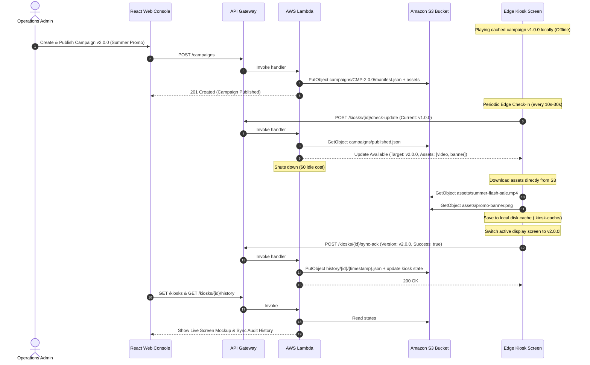

# CloudFleet — Serverless Edge Kiosk & Digital Signage Fleet Management System

[](https://github.com/Pratiksawant14/CloudFleet/actions/workflows/ci.yml)
[](https://nodejs.org/)
[](https://www.terraform.io/)
[](https://aws.amazon.com/serverless/)
[](LICENSE)

**CloudFleet** is a cloud-native, serverless fleet management and content distribution platform engineered for **offline-first edge kiosks and digital signage displays** (such as retail store screens, interactive malls, and transit terminals).

---

## The Real-World Cloud Computing Problem

### 1. The Offline-First Edge Reality
Smart kiosks and digital advertising screens placed in retail stores, shopping malls, and public spaces run locally for hours or days. 
- **They do NOT require constant internet streaming** to play high-definition videos, product catalogs, or interactive store directories.
- Streaming video 24/7 over the internet to thousands of public screens would cause extreme cloud bandwidth egress costs, buffering freezes, and downtime whenever the internet drops.
- Instead, assets must be stored and executed **locally in edge cache**, allowing uninterrupted local playback.

### 2. The Serverless Architecture Choice: Why Lambda + S3 over 24/7 EC2 & MQTT?
- **Why NOT 24/7 EC2 or continuous MQTT?** 
  Continuous publish-subscribe models (like MQTT) and dedicated EC2 virtual machines require servers to run 24/7/365, incurring constant computing and hosting charges even when no updates are being pushed.
- **Why AWS Lambda + Amazon S3?**
  Digital campaigns only change periodically (e.g. weekly flash sales, holiday promotions, or menu updates). 
  - **Zero Idle Cost**: AWS Lambda only activates for milliseconds when an edge kiosk queries for updates or reports its heartbeat, and shuts down immediately.
  - **S3 as Central Asset Repository**: Amazon S3 hosts the heavy multimedia assets (promotional videos, high-resolution banners, and manifest JSON files) with 99.999999999% durability at object storage pricing.
  - **Direct Edge Download**: When an update is detected, the kiosk downloads the heavy bundles from S3 into its local disk cache (`.kiosk-cache/`), verifies the payload, updates its screen locally, and sends an acknowledgement.

---

## System Architecture

```
                       +-----------------------------------+
                       |    Fleet Operations Dashboard     |
                       |      (React / TypeScript SPA)     |
                       +-----------------------------------+
                                  |              ^
            1. Publish Campaign   |              | 6. Poll Fleet Status &
               with Media Assets  v              |    Sync Audit Logs
                       +-----------------------------------+
                       |     Amazon API Gateway (HTTP)     |
                       +-----------------------------------+
                                  |              ^
                                  v              |
                       +-----------------------------------+
                       |      AWS Lambda Compute Engine    |
                       |  (Kiosk Registry & Update Logic)  |
                       +-----------------------------------+
                                  |              |
           2. Store Manifests     |              | 3. Query Active
              & Asset Metadata    v              v    Campaigns
                       +-----------------------------------+
                       |      Amazon S3 Object Store       |
                       |  campaigns/{id}/manifest.json     |
                       |  assets/{assetId}.mp4 / .png      |
                       |  kiosks/{id}/state.json           |
                       |  history/{id}/{timestamp}.json    |
                       +-----------------------------------+
                                  ^              |
           4. Check for Update /  |              | 5. Download Heavy Assets
              Heartbeat / Sync-Ack|              |    into Local Disk Cache
                                  |              v
                       +-----------------------------------+
                       |     Edge Kiosk Fleet Device       |
                       |     (Offline Local Playback)      |
                       |     Local Disk: .kiosk-cache/     |
                       +-----------------------------------+
```

---

## Core Operational Workflow



---

## Project Structure

```text
CloudFeet/
├── backend/                  # Serverless AWS Lambda Handlers & S3 Service Layer
│   ├── src/
│   │   ├── handlers/api.ts   # Lambda HTTP API entry point (routing)
│   │   ├── services/
│   │   │   ├── storage.ts    # Dual S3 / Local-disk filesystem abstraction
│   │   │   ├── kioskService.ts    # Kiosk registration, heartbeats & status
│   │   │   ├── campaignService.ts # Campaign creation & S3 asset staging
│   │   │   └── syncService.ts     # Update detection, asset manifest & sync ACK
│   │   ├── types/index.ts    # TypeScript interfaces (KioskState, CampaignManifest, etc.)
│   │   └── utils/logger.ts   # Structured JSON logger
│   ├── src/localServer.ts    # Local Express runner for offline development (port 4000)
│   └── src/test/             # Node.js native unit tests
├── frontend/                 # React + TypeScript + Vite Dashboard
│   ├── src/
│   │   ├── components/
│   │   │   ├── Header.tsx             # Navbar with quick campaign & kiosk actions
│   │   │   ├── FleetOverview.tsx      # Fleet KPIs (Deployed, Local Playback, Syncing)
│   │   │   ├── KioskTable.tsx         # Kiosk inventory with active screen displays
│   │   │   ├── KioskDetail.tsx        # Live edge screen preview, cache stats & audit
│   │   │   ├── CampaignModal.tsx      # Modal to author & push campaigns to S3
│   │   │   ├── RegisterKioskModal.tsx # Modal to provision new smart kiosks
│   │   │   └── SimulatorGuideModal.tsx# CLI instructions for evaluators
│   │   ├── services/api.ts            # Client API connector
│   │   └── App.tsx                    # Root dashboard application
│   └── index.html
├── simulator/                # Edge Kiosk Device Simulator
│   ├── src/
│   │   ├── kioskDevice.ts    # Kiosk state machine (local cache, offline loop, S3 sync)
│   │   ├── runner.ts         # Multi-kiosk CLI runner
│   │   └── demo.ts           # 10-step automated end-to-end verification demo
├── terraform/                # Infrastructure as Code
│   ├── main.tf               # Terraform AWS providers
│   ├── s3.tf                 # Encrypted S3 bucket & lifecycle rules
│   ├── lambda.tf             # AWS Lambda function & build package
│   ├── apigateway.tf         # HTTP API Gateway with CORS
│   └── iam.tf                # Least-privilege IAM policies
├── .github/workflows/ci.yml  # Automated CI build, test, and guarded Terraform deployment
├── CLOUDFLEET_PROJECT_KNOWLEDGE.md # Authoritative Project Architecture Document
└── package.json              # Monorepo workspaces definition
```

---

## Quickstart: Local Development & Demonstration

### 1. Install Dependencies
```bash
npm install
```

### 2. Start the Backend API (Terminal 1)
```bash
npm run dev:backend
```
- Listens on `http://localhost:4000`.
- Automatically initializes the S3 storage provider. In offline/local mode, all S3 objects and assets are stored in `.local-s3/`.

### 3. Start the Operations Dashboard (Terminal 2)
```bash
npm run dev:frontend
```
- Open [http://localhost:3000](http://localhost:3000) in your web browser.
- Displays the real-time kiosk fleet, live screen previews, campaign creation modal, and S3 sync audit logs.

### 4. Run the Automated 10-Step Verification Demo (Terminal 3)
```bash
npm run simulate:demo
```
This automated demo script runs the complete real-world scenario without manual clicking:
1. Verifies API Gateway & Lambda health.
2. Registers a new smart edge kiosk (`KIOSK-RETAIL-001`).
3. Boots the kiosk in **offline-first playback mode** playing default welcome content.
4. Kiosk checks cloud for updates -> Finds no new campaigns -> Resumes offline playback.
5. Admin publishes a new campaign (v2.0.0 Summer Flash Sale) with multimedia assets to S3.
6. Kiosk wakes up, queries Lambda, detects update v2.0.0.
7. Kiosk pulls video and graphic assets directly from S3 into local disk cache (`.kiosk-cache/`).
8. Kiosk switches active screen to v2.0.0 and posts sync ACK.
9. Operations console verifies sync audit log and screen state.
10. Simulator gracefully shuts down.

### 5. Run Continuous Multi-Kiosk Fleet Simulator
```bash
# Start 3 kiosks across multiple retail store locations
npm run dev:simulator

# Or simulate a custom kiosk with custom check interval
npm run dev:simulator -- --kiosk KIOSK-STORE-005 --location "Mall Atrium Screen" --interval 5000
```

---

## Cloud Computing Presentation Guide (For Evaluators & Viva)

When presenting this project in a Cloud Computing or Software Engineering evaluation, use this structured explanation:

### 1. The Core Architecture Principle: "Why Serverless?"
> *"Traditional kiosk and IoT systems often keep an EC2 server or MQTT message broker running 24/7. However, kiosks are edge devices that run locally and only require cloud intervention when campaign assets or schedules change. Running a dedicated 24/7 server produces 99% idle compute waste. In CloudFleet, we replaced this with a Serverless triad: Amazon API Gateway, AWS Lambda, and Amazon S3. When kiosks check in, Lambda spins up for milliseconds, executes the query, and shuts down, achieving true $0 idle cost."*

### 2. The Storage Decision: "Why Amazon S3?"
> *"Digital displays require heavy assets: 4K promo videos, high-resolution banners, and manifest bundles. Traditional databases (SQL or DynamoDB) are expensive and inefficient for storing multi-megabyte binary assets. Amazon S3 gives us virtually unlimited, durable, highly available object storage at a fraction of the cost. The metadata manifest (`manifest.json`) and the actual binary files are stored together in S3, allowing edge kiosks to download directly from the storage layer."*

### 3. Edge Computing & Offline-First Execution
> *"If the internet connection at a retail store goes down, the kiosk must not show an error screen or freeze. CloudFleet implements offline-first edge computing: once assets are pulled from S3, they are persisted to local storage (`.kiosk-cache/`). The kiosk plays smoothly from edge storage without touching the cloud until the next scheduled update."*

### 4. Infrastructure as Code (IaC)
> *"All cloud resources — API Gateway HTTP APIs, AWS Lambda functions, IAM security roles with least-privilege access, and encrypted S3 buckets — are fully codified using HashiCorp Terraform in the `terraform/` folder for repeatable, version-controlled cloud provisioning."*

---

## Running Automated Tests

```bash
# Run backend unit tests (Kiosk registration, campaign publishing, update check & sync ACK)
npm test --workspace=backend

# Build all monorepo workspaces (Backend, Frontend, Simulator)
npm run build
```

---

## Deploying to Real AWS with Terraform

When ready to deploy to your AWS account:

```bash
# 1. Configure AWS credentials
export AWS_ACCESS_KEY_ID="your-access-key"
export AWS_SECRET_ACCESS_KEY="your-secret-key"
export AWS_DEFAULT_REGION="us-east-1"

# 2. Build the project
npm run build

# 3. Deploy via Terraform
cd terraform
terraform init
terraform plan
terraform apply
```

Terraform will deploy the API Gateway, Lambda function, and S3 bucket, outputting the live `api_endpoint` URL.

---

## Authoritative Documentation
For deep-dive architectural rules, schema contracts, and design trade-offs, consult [CLOUDFLEET_PROJECT_KNOWLEDGE.md](file:///d:/Sem-5/CloudFeet/CLOUDFLEET_PROJECT_KNOWLEDGE.md).
